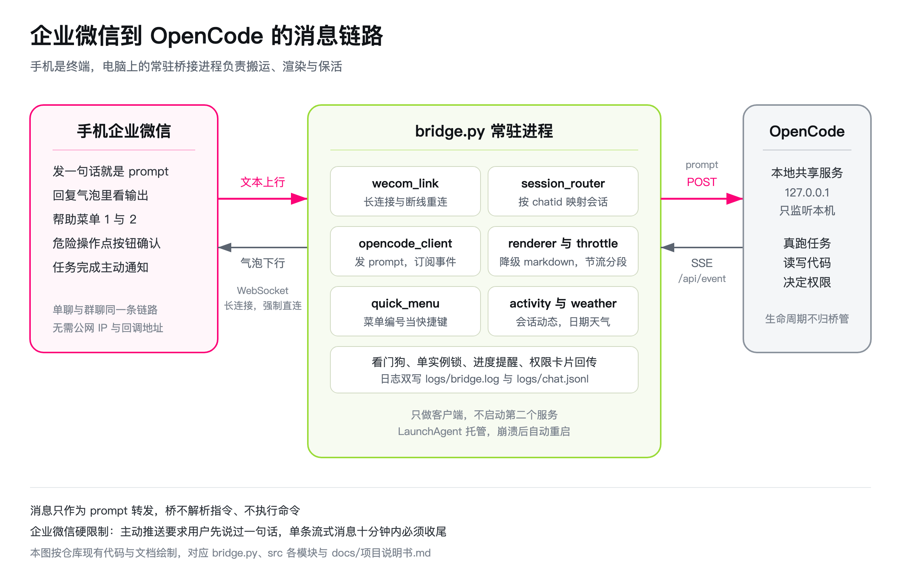

# 企业微信智能机器人长连接对接 OpenCode

用手机上的企业微信 App 当终端，通过消息驱动运行在电脑上的 OpenCode。

## 简介

在个人电脑上跑一个常驻进程，它同时连着两头：企业微信的 WebSocket 长连接，以及本机 opencode 共享后台服务的 HTTP 接口。你在手机上发一句话，它转成 OpenCode 的 prompt，拿到流式输出再推回企业微信。任务完成时主动推通知。需要人工确认的危险操作，做成按钮让你点。

桥只做客户端，服务生命周期归 opencode 自己管理。桥不自行启动第二个 `opencode serve`，所以不会和系统里的 opencode 服务抢端口，也不会让两个服务同时写同一个数据库。

选长连接而不是 Webhook 的原因：不需要公网 IP，不需要处理消息加解密，流式刷新由自己主动推送延迟低。代价是要自己维护心跳和断线重连。

## 效果图

本项目没有网页界面，交互全部发生在手机企业微信里，所以这里放的是真实代码对应的链路图，画出消息从手机到本机 OpenCode 的完整走向。



## 核心功能

1. 手机单聊发指令，电脑上的 OpenCode 干活，流式回显。
2. 任务完成主动推通知，不查不催。
3. 危险操作转成模板卡片，手机上点允许或拒绝，超时默认拒绝。
4. `/proj` 切换项目目录，带白名单校验。
5. 断线自动重连。企业微信侧由 SDK 无限重连，OpenCode 侧事件订阅断了会指数退避重订阅，两头都覆盖。启动脚本用 `caffeinate` 阻止系统休眠，因为空闲锁屏后机器会进入休眠，休眠期间长连接被掐断、消息会丢，唤醒后还要几十秒才检测到断线并重连。
6. 群聊支持，按 chatid 独立映射会话，强制串行。
7. 每 10 分钟给已知会话推一条时间戳加菜单，既确认进程活着，又顺手提醒可用功能与命令，防呆。
8. 模型提问工具已在桥的项目目录关闭：模型想澄清时直接把问题写成文字发到手机，不会挂起等表单。
9. 权限默认全部放行，不再往手机推确认卡片；卡片机制保留，需要确认时点一下即可，点击按官方字段层级解析，点完回写结果，点空了会收到提示。
10. 快捷菜单：输入 `help`、`帮助` 或 `?` 打开，目前两项功能，看 OpenCode 其他会话动态、看日期与天气。回复序号执行，序号在弹菜单后 180 秒内有效，`菜单2` 这类显式写法不受时间窗限制。
11. 长任务不漏尾：单条流式消息有 10 分钟硬上限，桥在 540 秒主动交接，把气泡收尾后改用独立消息续推，只推增量。
12. 常驻自愈：提供 LaunchAgent，开机自启，非零退出自动重启。重启重叠时新实例最多等 15 秒抢锁，抢不到再正常退出，不形成重启风暴。安装命令见下。
13. 非文本消息不再石沉大海：图片、文件、语音、图文混排会收到一条明确提示，原始帧落日志待采样。
14. 可靠性兜底：发送失败退避重试，任务长时间无事件看门狗强制收尾，待确认权限被新指令取消时回传拒绝，重启后对在途会话推中断通知。
15. 运行指标：每 10 分钟在日志里输出收到、回复、推送、失败、完成任务与活跃会话数。

详细设计与协议细节见 `docs/项目说明书.md`，本轮踩坑与教训见 `docs/经验教训.md`，锁屏休眠问题的完整取证与机制分析见 `docs/锁屏休眠与消息可靠性.md`。

## 使用方法

### 首次接入，四步做完

1. 创建机器人并拿凭证。后台操作步骤见本文末尾的机器人创建一节，关键是 API 配置区域选「使用长连接」，最后拿到 BotID 和 Secret 两个值。
2. 填配置。复制 `.env.example` 为 `.env`，必填三项见下面的配置表。`OPENCODE_BASE_URL` 保持默认的 `auto`，桥会自动读取 `~/.local/state/opencode/service.json` 里的服务地址与密码，不需要手工填。只有连接远端或独立服务时才写显式地址，那时才需要填 `OPENCODE_PASSWORD`。`WECOM_DEFAULT_DIR` 必须写一个已经存在的真实项目目录，不要指向临时目录，也不要留空。
3. 启动。在项目根目录执行 `./just_run.sh`，或双击 `run_me.command`。脚本依次做五件事：检测并创建 venv、按 `requirements.txt` 装依赖、校验 `.env` 必填项、确认 opencode 共享服务就绪（没起来时执行 `opencode service start`，不另起 serve）、最后启动 `bridge`。终端停在 bridge 的日志输出上就是正常状态。停止按 Ctrl+C：bridge 自己捕获信号，日志依次打「收到停止信号，正在退出」与「bridge 已退出」后干净退出。共享服务是 opencode 的，桥不会关它，也不该关它。
4. 手机验证。手机企业微信进入机器人会话，随便发一句话。首次进入会话会收到一条欢迎语，收到即代表长连接通了。随后发的第一条文字会自动在 `WECOM_DEFAULT_DIR` 指向的目录下新建 OpenCode 会话，第二条起复用同一个会话。

### 常驻运行与自愈

默认是终端前台运行，关掉终端就停。要开机自启与崩溃自愈，安装一次 LaunchAgent：

```
./scripts/install_launchd.sh
```

它会生成 `~/Library/LaunchAgents/ai.opencode.wecom.bridge.plist` 并加载，开机自启，非零退出 30 秒后重启。装完、卸载、查状态都用这同一个脚本：

1. 安装：`./scripts/install_launchd.sh`
2. 查状态：`./scripts/install_launchd.sh status`
3. 卸载：`./scripts/install_launchd.sh uninstall`

桥是单实例。重启瞬间新旧实例会短暂重叠，新实例会等旧实例释放锁，最多等 15 秒，避免两边都退出。要立刻重启，执行 `launchctl kickstart -k gui/$(id -u)/ai.opencode.wecom.bridge`。启动脚本已用 `caffeinate` 顶住系统休眠，锁屏期间不会掉线。

项目目录改名或搬家后，plist 里的绝对路径会失效，launchd 会以退出码 127 反复重试。搬家后重跑一次 `./scripts/install_launchd.sh` 即可。

### 日常怎么用

打开企业微信，进入机器人会话，直接发文字，不需要在电脑上做任何操作。发出去的文字就是发给 OpenCode 的 prompt，输出会以流式消息的形式在同一条气泡里增长，任务结束时气泡停止刷新。

### 会话里的命令

| 命令 | 作用 | 备注 |
| --- | --- | --- |
| 任意文字 | 作为 prompt 发给当前 OpenCode 会话 | 不带斜杠就是指令 |
| `help` 或 `帮助` 或 `?` | 打开快捷菜单 | 也接受 `/help` 与 `菜单` |
| 菜单编号 `1` | 看 OpenCode 其他会话在做什么 | 企业微信机器人按钮菜单的快捷键，任何时刻发 `1` 都直接执行，不进模型 |
| 菜单编号 `2` | 看今天的日期与所在城市天气 | 同上，快捷键优先；城市在 `WECOM_WEATHER_CITY` 配置，留空且未开启兜底会给出配置指引 |
| `/proj /绝对路径` | 切换项目目录 | 目标必须在 `WECOM_ALLOWED_DIRS` 白名单内，切换后会话重置，下一条消息新建会话 |
| `/new` | 清空当前会话 | 保留目录，只丢 sessionID |
| `/stop` | 中断正在跑的任务 | 没有运行中的任务时返回提示 |
| `/status` | 查看当前目录、会话 id、映射键 | 排查「消息发到哪个项目去了」用这条 |

### 快捷菜单

在会话里发 `help`、`帮助` 或一个 `?`，机器人回一条菜单。菜单目前两项功能，回复对应序号执行。

菜单编号是系统快捷键，不是对话选项。企业微信机器人自带的按钮菜单点击后送到后端的也是纯文本 `1`、`2`，与手打无法区分，所以这两个数字在任何时刻都直接执行菜单，不进模型，也不受任务锁影响。用户在 2026-10-10 就明确要求过不要做编号选项交互，原话是「不要搞这种画蛇添足的事情」，这条是硬约束。

1. 其他会话动态。列出 OpenCode 上最近的会话，显示标题、所属目录、状态与最后活动时间，运行中的排在最前，当前这个微信对话的会话会被排除。
2. 日期与天气。显示当前日期、星期、时间，以及所在城市的天气，数据来自 Open-Meteo 免费接口，无需密钥。城市取 `WECOM_WEATHER_CITY`，留空则用 IP 定位兜底。

菜单项定义在 `src/quick_menu.py` 的 `ITEMS` 表里，新增功能往表里加一条即可，编号自动跟着变。触发词匹配、序号解析、菜单渲染都在这个模块，网络与业务逻辑留在 bridge 里。

### 群聊用法

群聊与单聊的差别只有三点，其余完全相同。

1. 必须 @机器人 才会收到回调，收到的文本里带 @机器人 前缀，bridge 会自动剥掉。配了 `WECOM_ROBOT_NAME` 按名称精确剥，没配则剥离开头的第一个 @提及。
2. 群目录按群单独配置，写 `WECOM_GROUP_DIRS`，格式是 JSON 对象，键是群 chatid，值是目录绝对路径。没有配置的群一律拒绝执行，不会回退到单聊默认目录。
3. 同一个群里多人同时说话会串行排队，前一条处理完才处理下一条。

### 危险操作的确认流程

OpenCode 发起权限请求时，bridge 会往同一个会话推一张模板卡片，带允许一次和拒绝两个按钮，描述里附上本次操作涉及的文件或资源清单。手机上点的结果回传给 OpenCode，点完卡片立刻更新成已处理，不能重复点。超过 `CONFIRM_TIMEOUT_SEC` 秒没有响应按拒绝处理，并给一条超时通知，默认不放行。除 allow 与 deny 之外的按键事件一律按拒绝处理。

### 心跳消息

bridge 启动后等一个间隔推第一条，之后每 `HEARTBEAT_INTERVAL_SEC` 秒推一次，默认 600 秒即 10 分钟。内容是第一行本地时间戳，下面是快捷菜单与控制命令，和发 `help` 看到的一致：

```
2026-10-10 17:30:00

**快捷菜单**
1. 其他会话动态 —— ...
2. 日期与天气 —— ...
...
**控制命令**
/proj /new /stop /status
```

加菜单是防呆：平时忘了有哪些功能，每 10 分钟被提醒一次，而且推完菜单会打开 180 秒选择窗口，直接回 `1` 或 `2` 就能执行。这条消息同时承担心跳与提醒两个作用。它服从企业微信的硬限制：主动推送要求用户先在会话里给机器人发过一句话。所以 bridge 刚启动、还没人说过话时，心跳打在日志里是「心跳无可推目标，等用户先发一句话」，一条也发不出去。用户开口之后才开始正常推送。

单聊和群聊都会推。每个会话每 10 分钟一条，折算每小时 6 条，远低于企业微信单会话 1000 条每小时的上限。把 `HEARTBEAT_INTERVAL_SEC` 设成 0 可以关掉。

### 一个已经存在的混淆点

OpenCode 自己也有心跳，两者不是一回事，不要混：

1. OpenCode server 在 `GET /api/event` 建连后立刻推一条 `server.connected`，之后每 15 秒推一行 `: heartbeat` 注释，没有时间戳。那是 SSE 协议层保活，bridge 收到就丢，不上手机。
2. 本项目的心跳是 bridge 主动推给企业微信用户的，每 10 分钟一条，带时间戳。

## 配置项

`config.py` 全部读环境变量，`.env` 落盘并已进 `.gitignore`。

| 变量 | 必填 | 说明 |
| --- | --- | --- |
| `WECOM_BOT_ID` | 是 | 机器人 BotID |
| `WECOM_BOT_SECRET` | 是 | 长连接专用 Secret |
| `WECOM_ROBOT_NAME` | 否 | 机器人名称，配了才按名称精确剥离群聊 @ 前缀，不配则剥离开头的第一个 @提及 |
| `WECOM_OWNER_IDS` | 否 | 允许使用机器人的 userid 白名单，JSON 数组或逗号分隔，留空则不限制 |
| `OPENCODE_BASE_URL` | 否 | 默认 `auto`，自动发现 opencode 共享服务；只有连接远端或独立服务时才写显式地址 |
| `OPENCODE_USERNAME` | 否 | 默认 `opencode` |
| `OPENCODE_PASSWORD` | 否 | 仅显式地址模式需要。`auto` 模式下密码由服务登记文件提供，这里的值会被忽略 |
| `WECOM_DEFAULT_DIR` | 是 | 单聊默认项目目录，必须是已存在目录 |
| `WECOM_GROUP_DIRS` | 否 | 群聊目录映射，JSON 对象，未配置的群拒绝执行 |
| `WECOM_ALLOWED_DIRS` | 否 | 允许 `/proj` 切换的目录白名单，JSON 数组，留空则禁止切换 |
| `STREAM_MIN_CHARS` | 否 | 流式刷新字符阈值，默认 300 |
| `STREAM_MIN_INTERVAL` | 否 | 流式刷新时间下限秒数，默认 2 |
| `RENDER_MAX_CHARS` | 否 | 单条消息字符上限，默认 3000 |
| `HEARTBEAT_INTERVAL_SEC` | 否 | 心跳间隔秒数，默认 600 即 10 分钟，填 0 关闭 |
| `CONFIRM_TIMEOUT_SEC` | 否 | 确认超时秒数，默认 300，超时视为拒绝 |
| `WECOM_WEATHER_CITY` | 否 | 天气功能所用城市，留空且未开启兜底会提示去配置 |
| `WECOM_WEATHER_IP_FALLBACK` | 否 | 城市留空时是否用 IP 定位兜底，默认 0 关闭 |

## 日志

bridge 把所有运行记录写进项目根目录的 `logs/` 目录，两个文件，启动时自动创建：

| 文件 | 内容 |
| --- | --- |
| `logs/bridge.log` | 运行日志，与终端输出同步双写，带日期时间。超过 5MB 自动轮转为 `bridge.log.1` |
| `logs/chat.jsonl` | 聊天记录，每条一行 JSON，与运行日志分开存 |

聊天记录的字段：`ts` 时间，`dir` 方向（收是你发的，发是机器人回的），`key` 映射键，`kind` 消息类别（text、stream、finish、continue、reply、error、card、card_event、welcome、notice），`content` 内容，超过 2000 字符截断并把 `truncated` 置为 true。

排查任务中断这类问题，直接看 `logs/bridge.log` 里的 ERROR 行。会话出错时 ERROR 行带两段：摘要是错误原文，后面附原始事件全文，例如上游返回的 key limit exceeded 这类模型侧错误会原样落在日志里，不猜不省略。

日志级别用环境变量 `BRIDGE_LOG_LEVEL` 调，可选 DEBUG、INFO、WARN、ERROR，默认 INFO。

## OpenCode 每日工作记录

查当天 OpenCode 干了什么并留档，产物在 `docs/opencode工作记录/<日期>.md`，按项目分组列出每个会话的标题、状态、时间段、花费与动用的工具。

1. 手动触发：在任意项目里输入 `/日报`。
2. 命令行：`zsh scripts/run_opencode_daily_report.sh`。想省钱就前置 `OPENCODE_REPORT_MODEL=opencode/mimo-v2.6-flash-free`。
3. 只取原始数据不花 token：`.venv/bin/python scripts/opencode_daily_report.py`。

设计与踩坑见 `开发记录.md` 同日的条目。

## 环境要求

1. macOS 或 Linux，Python >= 3.8。
2. 已安装 OpenCode，本机实测版本 v2.0.22。
3. 有一个企业微信企业账号，能创建智能机器人。

## 已知限制

1. 企业微信侧每个机器人只能有一个有效长连接，本项目不做主备，只跑单实例。启动时若检测到已有实例在跑，直接退出并打印对方进程号，不会互踢。
2. 主动推送要求用户先在会话里发过一句话，否则推不到。
3. 流式消息 10 分钟内必须结束，否则企业微信自动截断。
4. 单会话 30 条/分钟、1000 条/小时，超了会被限。
5. 企业微信 markdown 不支持表格和高亮，渲染器会降级。
6. 会话映射会落盘到项目根目录的 `.sessions.json`，bridge 重启后自动恢复，不再清零。若 OpenCode 侧会话已不存在，下一条消息会自动重建。
7. OpenCode 侧 session 失效时 bridge 会自动重建并重发一次，仍失败才向用户报错。

## 常见问题

1. 启动时报缺少必填配置。`just_run.sh` 会逐项检查 `WECOM_BOT_ID`、`WECOM_BOT_SECRET`、`WECOM_DEFAULT_DIR` 三项，缺哪项就填哪项。
2. 启动时报 opencode 共享服务未就绪。先跑 `opencode service status` 看地址，再看 `~/.local/share/opencode/log/opencode.log` 的 `level=ERROR` 行。服务卡住或端口被占时执行 `opencode service restart`。不要为了绕过它再手动起一个 `opencode serve`，那会重新引入端口与数据库竞争。
3. 手机发了消息没有任何回复。先看 bridge 终端的日志，正常会打印「收到消息 key=...」。没有这行说明长连接没通或可见范围不含这个账号；有这行但没有后续回复，说明卡在 OpenCode 侧。
4. 群里发消息机器人不理。三个原因：没有 @机器人；这个群没写进 `WECOM_GROUP_DIRS`；机器人可见范围没包含这个群。日志里会打印拒绝原因。
5. 超长输出的去哪了。单条消息上限由 `RENDER_MAX_CHARS` 控制，默认 3000 字符。收尾消息发首片，剩余内容按上限分块用普通消息续推，每条带 (2/5) 这样的序号，不会丢内容。这是企业微信 markdown 的显示上限假设值，数值本身还没做真实实测。
6. 遇到企业微信限流。限制是单会话 30 条/分钟、1000 条/小时。一轮长回答按 300 字符或 2 秒一批推送，触发限流就调大 `STREAM_MIN_CHARS` 和 `STREAM_MIN_INTERVAL`。
7. 终端里报 SOCKS proxy 相关错误。两处都已堵住：访问本机 `127.0.0.1` 的 HTTP 客户端关闭了代理环境变量读取，企业微信长连接强制 `proxy=None` 直连。若日志里仍每 30 秒刷一条 `connecting through a SOCKS proxy requires python-socks`，说明跑的是旧代码，重启 bridge 即可。
8. 手机上点了权限卡片没反应。已修：卡片事件的真实字段在 `event.template_card_event.event_key` 与 `.task_id`（官方「接收事件」文档，最后更新 2026/05/20），旧代码少读一层导致点击全丢。现在点空会收到一条提示，点中会回写卡片结果。当前配置已放行全部权限，正常情况下不会再收到卡片。

## 安全须知

1. 桥不启动服务，服务由 opencode 托管，默认只监听 `127.0.0.1`。不要把它改成 `0.0.0.0`，那等于把 shell 访问权开放到网络上。
2. `.env` 权限设 600，已在 `.gitignore` 里。
3. 单连接限制：不要同时跑两个实例，新连接会踢掉旧连接。
4. 消息内容只作为 prompt 送进 OpenCode，bridge 不解析指令、不执行命令、不做权限决策，权限判断全在 OpenCode 侧。
5. 手机丢失时最后一道闸是 OpenCode 的权限确认卡片，超时默认拒绝。

## 机器人创建

1. 企业微信管理后台，安全与管理，管理工具，智能机器人，创建机器人。
2. 手动创建，拉到底部选 API 模式创建。
3. 先填名称和可见范围，保存。
4. API 配置区域选「使用长连接」。
5. 复制 BotID，点获取拿 Secret。
6. 长连接模式不需要填 URL、Token、EncodingAESKey。

官方文档：developer.work.weixin.qq.com/document/path/101463

## 验证

```
./tests/run_tests.sh
```

脚本自带四个部分：纯逻辑用例、自找空闲端口、全部 Python 文件语法自检、OpenCode 接口契约核对。结束时按进程号精确关闭临时拉起的 serve，不用 pkill。

纯逻辑用例现在有十个文件，其中 `test_bridge_stream.py` 用 mock 的链接与客户端覆盖 bridge 主流程：命令回复收尾、群聊剥离与拒绝、权限超时、卡片按键白名单、事件聚合、出错收尾、超长分段、会话重建、不走系统代理、单实例锁、快捷菜单分流、菜单时间窗、流式交接转推送、看门狗收尾、非文本消息提示、取消待确认回传拒绝、重启在途通知；`test_quick_menu.py` 覆盖菜单触发词、序号解析、前缀识别与渲染，`test_activity.py` 覆盖会话动态整理，`test_weather.py` 覆盖天气代码翻译、报告格式与空城市拦截。

另有只读事件探针 `tests/probe_events.py`，只订阅 `GET /api/event`，不发 prompt 不建会话，用来抓真实事件样本：

```
.venv/bin/python tests/probe_events.py --dry-run
.venv/bin/python tests/probe_events.py --seconds 120
```

已实测确认的事实：

1. API 前缀是 `/api`，共 116 条路径，全部经 `openapi.json` 契约核对。
2. 发消息用 `POST /api/session/{sessionID}/prompt`，body 是 `text` 字段，契约核对已覆盖请求体字段。
3. 建会话 `POST /api/session` 的 body 用 `location.directory` 指定目录，响应体是 `{"data": {...}}` 包裹，代码已解包，契约核对已覆盖请求体字段。
4. 权限决策枚举为 `once`、`always`、`reject`；权限对象字段为 id、sessionID、action、resources、message，来自 `Permission.Request` schema。
5. 事件形状为 `{id, type, data}`，订阅口是 `GET /api/event`。
6. `openapi.json` 受认证保护，无凭据返回 401。
7. 文本流与完成信号的真实事件形状，来自真实任务采样：文本走 `session.text.started` / `session.text.delta`（data 带 delta 增量）/ `session.text.ended`（data 带 text 全文），按 assistantMessageID 加 ordinal 建槽位聚合；完成信号是 `session.execution.succeeded`，失败信号是 `session.execution.failed`。`message.part.*` 与 `session.idle` 在 `GET /api/event` 上实测不出现，bridge 不再依赖它们。

尚未验证：

1. 企业微信 markdown 消息的实际字符上限，暂按 3000 字符分段。
2. 两类文本事件在真实任务里的出现频率与搭配，聚合逻辑按两种语义都实现，缺真实任务样本，用上面的探针抓。
3. 权限卡片按钮点击事件的真实字段形状，等一次真实权限确认时用 `tests/probe_opencode.py` 采样。
4. 端到端全链路，`.env` 凭证虽已填，但要先解决多实例互踢再起新连接。
